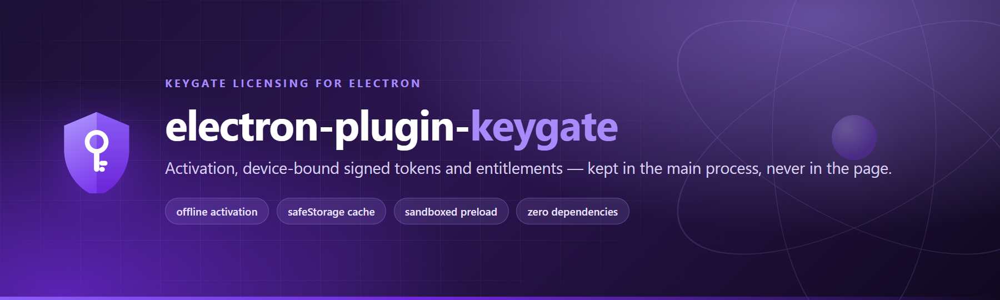
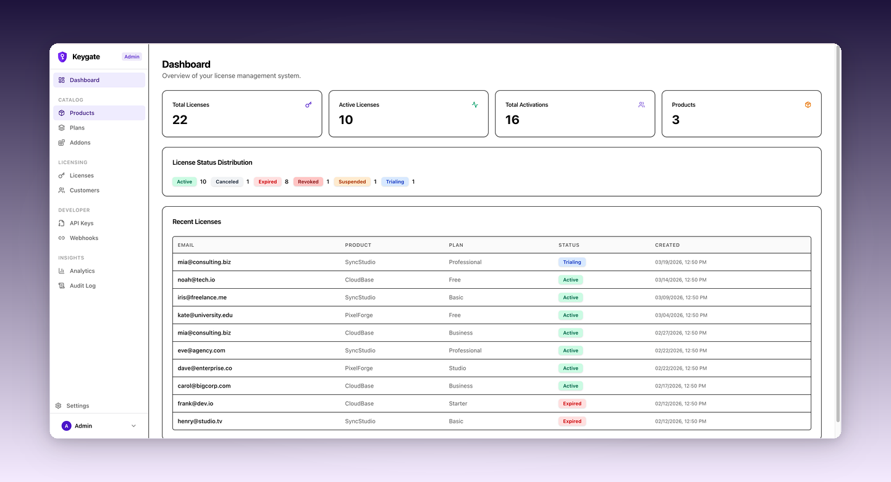
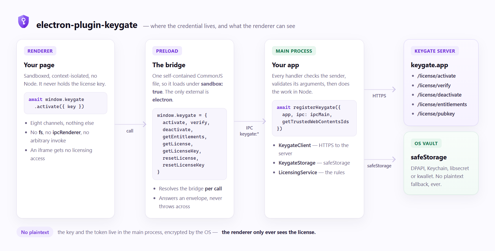

# electron-plugin-keygate

Licensing for Electron applications that use [Keygate](https://keygate.app).

Activation, device-bound signed tokens, offline restore and entitlements —
behind a sandbox-first preload bridge. Every credential stays in the main
process; the renderer gets eight typed IPC channels and nothing else.

```ts
import { keygate, isKeygateError } from 'electron-plugin-keygate/renderer';

const license = await keygate.activate({ key: 'KG-XXXX-XXXX-XXXX-XXXX' });
if (license.entitlements.includes('premium_support')) {
  // ...
}
```

<br />

## 🔌 Powered by Keygate

<a href="https://keygate.app" target="_blank">
  
</a>

[Keygate](https://keygate.app) is open-source license management: products,
plans, licenses, activations, customers and a portal to sell from. This
package is the **desktop client** for it — the part that lives inside your app
and talks to your users' machines.



<br />

## 📖 Table of Contents

- [Table of Contents](#-table-of-contents)
- [Powered by Keygate](#-powered-by-keygate)
- [Install](#-install)
- [Setup](#-setup)
  - [Main process](#-main-process)
  - [Configuration](#-configuration)
  - [Preload](#-preload)
  - [Renderer](#-renderer)
- [Usage](#-usage)
  - [activate()](#-activate)
  - [verify()](#-verify)
  - [deactivate()](#-deactivate)
  - [getEntitlements()](#-getentitlements)
  - [getLicense() and getLicenseKey()](#-getlicense-and-getlicensekey)
  - [resetLicense() and resetLicenseKey()](#-resetlicense-and-resetlicensekey)
- [How it fits together](#-how-it-fits-together)
- [The security model](#-the-security-model)
  - [Sender trust](#-sender-trust)
  - [Argument validation](#-argument-validation)
  - [Storage](#-storage)
- [The offline window](#-the-offline-window)
  - [The signed token](#-the-signed-token)
  - [When the server withdraws the license](#-when-the-server-withdraws-the-license)
- [Error codes](#-error-codes)
- [What this package is for](#-what-this-package-is-for)
  - [Licensing a person, not a machine](#-licensing-a-person-not-a-machine)
- [This is a Keygate client, not a Keygen one](#-this-is-a-keygate-client-not-a-keygen-one)
- [Deliberately absent](#-deliberately-absent)
- [Testing](#-testing)
- [Releasing](#-releasing)
- [Licence](#-licence)

<br />

## ⬇️ Install

```sh
npm install electron-plugin-keygate
```

`electron >= 30` is a peer dependency. The package itself has **no runtime
dependencies** — `node:crypto` and `node:fs` are enough.

<br />

## 🛠️ Setup

### ⚙️ Main process

```ts
import { app, BrowserWindow, ipcMain } from 'electron';
import { registerKeygate } from 'electron-plugin-keygate';

const windows = new Set<BrowserWindow>();

app.whenReady().then(async () => {
  const window = new BrowserWindow({
    webPreferences: {
      preload: [
        // The app's own preload, then the Keygate bridge.
        join(__dirname, '../preload/index.mjs'),
        // The sandboxed bridge. See "Preload" below.
        keygateSandboxedPreloadPath(),
      ],
      sandbox: true,
      contextIsolation: true,
    },
  });
  windows.add(window);

  // The channels exist from the first moment, so an early call answers
  // LICENSING_DISABLED rather than hanging.
  await registerKeygate({
    app,
    ipc: ipcMain,
    // Re-read per request: a closed window loses access by itself.
    getTrustedWebContentsIds: () => [...windows].map((w) => w.webContents.id),
  });
});
```

`registerKeygate` registers the IPC channels **before** `whenReady()` resolves,
so a renderer that calls early gets an answer rather than a hang. It also
restores the cached license at startup — offline, with no network call.

### 🔑 Configuration

The configuration comes from the environment:

| Variable | Meaning |
| --- | --- |
| `KEYGATE_API_URL` | The Keygate server. **Unset means licensing is off.** |
| `KEYGATE_PUBLIC_KEY` | The Ed25519 public key, hex. Pinning it is optional but stronger. |
| `KEYGATE_IDENTIFIER` | Override the device identifier. |
| `KEYGATE_REQUEST_TIMEOUT_MS` | Per-request timeout. Default 30 000. |
| `KEYGATE_MAX_CLOCK_DRIFT_SECONDS` | Tolerated clock disagreement. Default 300. |

Or configure it in code:

```ts
import { KeygateBuilder, registerKeygate } from 'electron-plugin-keygate';

const config = KeygateBuilder.new('https://keygate.app')
  .publicKey('a'.repeat(64))
  .build();

await registerKeygate({ app, ipc: ipcMain, getTrustedWebContentsIds, config });
```

`config: null` turns licensing off explicitly, without touching the
environment.

### 🌉 Preload

```ts
import { keygateSandboxedPreloadPath, keygatePreloadPath } from 'electron-plugin-keygate';

// For sandbox: true — CommonJS, self-contained.
keygateSandboxedPreloadPath(); // dist/preload/sandboxed.cjs

// For sandbox: false — ESM.
keygatePreloadPath(); // dist/preload/index.mjs
```

Both install the same bridge on `window.keygate`.

A sandboxed renderer cannot load an ESM preload, and it cannot reach the
package's other files at runtime. `keygateSandboxedPreloadPath()` returns a
**single self-contained CommonJS file** — the bridge is bundled in at build
time, with `electron` as the only external.

```ts
webPreferences: {
  preload: [keygateSandboxedPreloadPath()],
  sandbox: true,
  contextIsolation: true,
}
```

### 🖥️ Renderer

```ts
import { keygate, isKeygateError } from 'electron-plugin-keygate/renderer';

try {
  const license = await keygate.activate({ key });
  console.log(license.planName, license.entitlements);
} catch (err) {
  if (isKeygateError(err)) {
    switch (err.code) {
      case 'LICENSE_EXPIRED':
      case 'LICENSE_SUSPENDED':
      case 'LICENSE_REVOKED':
      case 'ACTIVATION_LIMIT':
      case 'DEVICE_HELD':
        showActivationProblem(err.detail);
        break;
      default:
        showTemporaryProblem(err.detail);
    }
  }
}
```

<br />

## ⚡ Usage

The renderer API has eight methods. Each one resolves to a value or rejects
with a `KeygateError`; nothing throws across the process boundary.

### 🎫 `activate()`

Registers this device against a license and gets a signed token.

| Argument | Type | Required | Default | Meaning |
| --- | --- | --- | --- | --- |
| `key` | `string` | ✅ | — | The license key. Capped at 256 characters. |
| `label` | `string` | | the device name | Shown in the customer portal, so the customer recognises the machine. |
| `identifier` | `string` | | the machine id | Overrides the device identifier. Required when `identifierType` is `user`. |
| `identifierType` | `'device' \| 'user'` | | `'device'` | Whether the identifier names a machine or a person. |

Resolves to `KeygateLicense`. Rejects with `NO_IDENTIFIER`, `REQUEST_ERROR`,
`BAD_RESPONSE`, `STORAGE_UNAVAILABLE`, or a server code.

```ts
const license = await keygate.activate({ key: 'KG-XXXX-XXXX-XXXX-XXXX' });
```

What happens under the hood:

1. the OS vault is probed **before** the network call — a license that cannot
   be stored would look like one the app has and cannot keep;
2. `POST /license/activate` with the identifier and its type;
3. the returned token's signature is verified with the server's public key;
4. the token's device binding is checked, so a token issued for another
   machine or another product is rejected with `BAD_TOKEN`;
5. the key and the token are written to the vault, and the license is
   returned.

Re-activating a device that is already active is safe: the server answers
`already_activated` without taking a second slot.

### 🔍 `verify()`

Checks the license and this device's activation against the server.

| Argument | Type | Required | Default | Meaning |
| --- | --- | --- | --- | --- |
| `key` | `string` | | the cached key | The license key to verify. |
| `identifier` | `string` | | the machine id | Overrides the device identifier. |

Resolves to `KeygateLicense`. Rejects with `NO_LICENSE`, `NOT_FOUND`, or a
server code.

```ts
const license = await keygate.verify();
```

`POST /license/verify` returns a fresh signed token, which is verified and
written back to the cache. The server answers `404 LICENSE_NOT_FOUND` for a
license that does not exist, one that is suspended or revoked, and one where
this device has no activation — deliberately the same answer for all three, so
the endpoint cannot be used to probe which keys are real.

### 🚪 `deactivate()`

Releases this device's activation slot, so another machine can take it.

| Argument | Type | Required | Default | Meaning |
| --- | --- | --- | --- | --- |
| `key` | `string` | | the cached key | The license key to deactivate. |
| `identifier` | `string` | | the machine id | Overrides the device identifier. |

Resolves to `void`. Rejects with `NO_LICENSE` or a server code.

```ts
await keygate.deactivate();
```

`POST /license/deactivate` frees the slot, and the cached token is cleared —
the device is no longer activated, so it must not keep the app licensed. The
**key is kept**, so the app can verify again without asking the customer to
retype it.

The server does not check the license's status here: a suspended or expired
license can still free its slots, which is what makes this useful for a
customer moving machines.

### 🎟️ `getEntitlements()`

The license's feature map, with quota usage when the server is reachable.

| Argument | Type | Required | Default | Meaning |
| --- | --- | --- | --- | --- |
| `key` | `string` | | the cached key | The license key to check. |
| `feature` | `string` | | — | Ask about one feature only. |

Resolves to `KeygateEntitlements`. Rejects with `NO_LICENSE` or a server code.

```ts
const entitlements = await keygate.getEntitlements();
if (entitlements.features['premium_support']?.enabled) {
  // ...
}
```

The signed token already carries the feature map, so when the server cannot be
reached the answer falls back to the token — verified, offline, but without
the quota figures.

### 💾 `getLicense()` and `getLicenseKey()`

`getLicense()` returns the license in force, or `null` when the app is
unlicensed. It reads the in-memory state: no I/O, no network.

`getLicenseKey()` returns the cached license key, decrypted, or `null` when
there is none.

```ts
const license = keygate.getLicense();
const key = await keygate.getLicenseKey();
```

The key is cached separately from the license, so the app can re-verify
without asking the customer to retype it — and so the renderer can show a
"your license key is still saved" state without holding the key itself.

### 🧹 `resetLicense()` and `resetLicenseKey()`

`resetLicense()` clears the cached token and the in-memory state. The **key is
kept**: it is the credential, not the state.

`resetLicenseKey()` clears the cached key as well.

```ts
await keygate.resetLicense();    // forget the license, keep the key
await keygate.resetLicenseKey(); // forget the key too
```

<br />

## 🏗️ How it fits together



The renderer never holds the credential. It asks the main process to do the
eight things above, and the main process does them in Node — over HTTPS, with
the license stored in the OS vault.

<br />

## 🔐 The security model

### Sender trust

The requesting web contents must be in the trust list *and* the frame must be
that window's main frame. An iframe gets no licensing access even inside a
trusted window. The trust list is re-read per request, so closing a window
removes its access with no cleanup.

### Argument validation

Every payload is checked before a license is touched. Keys are capped at 256
characters and rejected if they contain control characters.

### Storage

Under `app.getPath("userData")`:

```
userData/keygate/key     the license key, encrypted
userData/keygate/token   the signed token and its state, encrypted
```

Both are encrypted with Electron's `safeStorage` — DPAPI on Windows, the
Keychain on macOS, libsecret or kwallet on Linux. **There is no plaintext
fallback.** Linux's `basic_text` backend counts as unusable, because the
"key" is a fixed string in a world-readable file.

The package speaks both generations of the `safeStorage` API, so it works on
Electron 30 through 46 and beyond: the synchronous trio on 30–45, the
asynchronous trio on 45+. Electron 46 removed the synchronous one, so the
asynchronous API is preferred whenever it is present.

<br />

## 📴 The offline window

### The signed token

Keygate issues an Ed25519-signed token rather than a checked-out machine
file. The token carries:

| Field | Meaning |
| --- | --- |
| `exp` | The **check-in interval** — how long the client may stay offline before verifying again. |
| `vun` | The **license term** — when the license itself lapses. Absent means perpetual. |
| `grc` | Grace days after `vun`. |
| `upd` | End of the maintenance period, for a perpetual license. |
| `fpr` | The device binding: `sha256(identifier + ":" + product_id)`, first 8 bytes. |

The client verifies the signature locally with the server's public key, so
**a license can be restored on launch with no network at all**. The server
clamps `exp` so it never outlives `vun` plus the grace days, and the client
honours both.

The token is `base64url(payload-json) + "." + base64url(ed25519-signature)`,
and **the signed bytes are the base64url payload string, not the JSON**.
Signing or verifying the JSON instead is the most common integration mistake
here: it produces a token that looks well-formed and is rejected by the
server.

The consequence worth knowing: a license revoked on the server is still
honoured offline until the cached token's `exp` passes. Shorten the
check-in interval on the plan to shorten that window.

### When the server withdraws the license

A `verify` that fails with `LICENSE_NOT_FOUND` **clears the cached token and
the cached key**, and the app starts unlicensed on the next launch. Without
that, the cached token would be restored on every launch and the app would
keep running licensed on a license the server has withdrawn.

A failure that is not about the license — a lockout, a rate limit — clears
nothing, and neither does a verify of a *different* key: a customer trying a
second license does not lose the one this device already has.

<br />

## 🚨 Error codes

`KeygateError` carries `{ code, detail }`. The detail is a human-readable
sentence and never contains key material.

| Code | Meaning |
| --- | --- |
| `CONFIG` | The configuration cannot be used. |
| `LICENSING_DISABLED` | Licensing is not configured in this build. |
| `UNTRUSTED_SENDER` | The frame is not a trusted main frame. |
| `NO_IDENTIFIER` | This machine has no usable device identifier. |
| `REQUEST_ERROR` | The request failed or timed out. |
| `HTTP_ERROR` | The server answered with an unusable status. |
| `BAD_RESPONSE` | The server answered 2xx with a body this package cannot use. |
| `BAD_TOKEN` | The signed token is malformed or its signature does not verify. |
| `TOKEN_EXPIRED` | The signed token is past its offline lifetime. |
| `BAD_CACHE` | The cached offline state is past its lifetime or unverifiable. |
| `STORAGE_UNAVAILABLE` | The OS encryption vault is unusable. |
| `STORAGE_DECRYPT_FAILED` | Stored ciphertext could not be decrypted. |
| `NOT_ACTIVATED` | This device is not activated for the license. |
| `NO_LICENSE` | There is no license to act on. |
| `EXPIRED` | The license term is over, grace included. |
| `NOT_FOUND` | The server does not know this license. |
| `NO_KEYGATE_BRIDGE` | The window has no preload bridge. |
| `IPC_UNREACHABLE` | No handler is registered for the channel. |
| `unknown` | The envelope was not shaped the way this package expects. |

The server's own codes are passed through verbatim, so you can branch on
`LICENSE_EXPIRED`, `LICENSE_CANCELED`, `LICENSE_SUSPENDED`,
`LICENSE_REVOKED`, `ACTIVATION_LIMIT`, `DEVICE_HELD`, `FLOATING_LICENSE`,
`SEAT_PAUSED`, `FEATURE_NOT_AVAILABLE` and the rest.

<br />

## 🎯 What this package is for

**Licensing features inside an Electron app — offline activation above all.**
It activates a device, keeps a signed token for it, restores that token on
launch with no network, and gates features on what the license entitles.

It is **not** the place a customer buys a license. Buying, managing seats,
inviting people, upgrading plans and metering usage all live in the Keygate
portal or the server's own API; this package never touches them.

The Keygate server exposes eleven license endpoints. This package uses five:

| Endpoint | Used for |
| --- | --- |
| `GET /license/pubkey` | the key the server signs tokens with |
| `POST /license/activate` | register this device, get a token |
| `POST /license/verify` | check the license and this device |
| `POST /license/deactivate` | release this device's slot |
| `POST /license/entitlements` | which features the license grants |

The other six are deliberately out of scope, and the reasons are not
accidental:

| Not used | Why |
| --- | --- |
| `POST /license/usage`, `/usage/status` | metering — how the vendor bills, not how the app licenses itself. The entitlements answer already carries the quota figures an app needs to *show*. |
| `POST /license/floating/checkout`, `/checkin`, `/heartbeat` | floating licences are a different licensing model: a seat is leased and held, and there is no device-bound token to carry offline. This package's whole premise is the opposite. |
| `POST /license/download` | the updater's business, not the licensing client's. |
| `/releases/:product/feed.*` | Sparkle, Velopack and Tauri updater feeds. |

A floating licence is the one case worth naming: the server refuses
`activate` for one, with `FLOATING_LICENSE`. This package passes that code
through and says in the message that it does not implement that model,
rather than sending the app after an endpoint it cannot call.

### 👤 Licensing a person, not a machine

An activation belongs to **this machine** by default: the identifier is
derived from the operating system's machine id, hashed, and sent as
`identifier_type: "device"`.

An app that licenses people rather than machines says so, and names the
person:

```ts
await keygate.activate({
  key,
  identifier: 'person@example.com',
  identifierType: 'user',
});
```

The `identifier` is then required — the machine id is not a person, so the
package refuses to use it as one.

<br />

## 🚫 This is a Keygate client, not a Keygen one

The protocol here is **Keygate's** — the endpoints `/license/activate`,
`/license/verify`, `/license/deactivate`, `/license/entitlements` and
`/license/pubkey`, and the signed-token scheme described above.

Keygen's plugin was read as an *architectural* reference only — for the
preload layout, the IPC trust model and the shape of the offline cache.
Keygen's **wire protocol is different and is not implemented here**: it uses
`/v1/licenses/…` paths and a server-controlled *machine file* for offline
validity, where Keygate issues a signed token that carries its own lifetime.

So this package is not a drop-in replacement for a Keygen client, and a
Keygen-shaped detail appearing in the code is a bug rather than a
compatibility feature.

<br />

## ✅ Deliberately absent

- No arbitrary-invoke channel, no filesystem channel, and no channel that
  reaches the network directly. The renderer can only ask the main process
  to do the eight things above.
- No plaintext fallback when OS encryption is missing.
- No weakening of signature verification, and no clock tolerance beyond
  `KEYGATE_MAX_CLOCK_DRIFT_SECONDS`.
- No billing or payment surface. The package is a client of Keygate, not
  a licensing server.
- The cached token is honoured offline until its `exp` passes. A license
  revoked in the meantime is not known until the next online check.

<br />

## 🧪 Testing

| Command | What it does |
| --- | --- |
| `npm test` | The whole automated suite. The live tests skip themselves. |
| `npm run typecheck` | TypeScript, no emit. |
| `npm run build` | Bundles the five entry points and writes the declarations. |
| `npm run smoke` | Checks that every entry point and the `exports` map resolve. |
| `npm run verify:electron` | A real Electron, a sandboxed renderer, every channel. |
| `npm run verify:packaged` | Installs the tarball into an app, packages it, runs it. |
| `npm run assets` | Redraws the README images. |

The checks that need a real server take the URL and the key from the
environment. **The key is never written to disk** — only ciphertext is:

```sh
KEYGATE_LIVE_URL=http://localhost:9000 \
KEYGATE_LIVE_KEY=KG-XXXX-XXXX-XXXX-XXXX \
  npm run test:live            # the client against a live server
```

```sh
KEYGATE_LIVE_URL=http://localhost:9000 \
KEYGATE_LIVE_KEY=KG-XXXX-XXXX-XXXX-XXXX \
  npm run verify:live          # the same, reporting each step
```

```sh
KEYGATE_LIVE_URL=http://localhost:9000 \
KEYGATE_LIVE_KEY=KG-XXXX-XXXX-XXXX-XXXX \
  npm run verify:live-electron # a real Electron, the real OS vault
```

`verify:live-electron` is the one that cannot be faked: it activates a real
license, lets the real `safeStorage` encrypt it, checks the files on disk are
ciphertext, and then starts a **second process with the network gone** to
prove the offline restore works. Set `KEYGATE_ELECTRON_PATH` to run it against
a different Electron build.

Those checks all release the slot they took, so the server is left as it was
found. To take one and **keep** it — to see the activation in the portal, or
to test against a machine that is already licensed:

```sh
KEYGATE_LIVE_URL=http://localhost:9000 \
KEYGATE_LIVE_KEY=KG-XXXX-XXXX-XXXX-XXXX \
  npm run activate:live
```

It uses the same device identifier a real install derives from the machine id,
so the activation looks like a real one. Release it again with:

```sh
npm run activate:live -- --release <identifier>
```

<br />

## 📦 Releasing

The package is published as `electron-plugin-keygate` on the public npm
registry, straight from `.github/workflows/publish.yml` — through npm's
**trusted publishing**, so no npm token is stored in this repository. The
workflow exchanges the job's GitHub identity for a short-lived publish token
and writes provenance for every release.

One setup step has to be done once, in npm rather than in GitHub:

```
npmjs.com -> electron-plugin-keygate -> Settings -> Trusted Publisher
  Organization or user : sarfarazstark
  Repository           : electron-plugin-keygate
  Workflow filename    : publish.yml
  Environment          : (leave empty)
```

The first version cannot go through that path, because npm only lets a package
be configured after it exists; publish it by hand once, then configure the
trusted publisher.

After that, a release is:

```sh
npm version 0.2.0        # commits the bump and tags it
git push --follow-tags
```

Publishing a GitHub release for that tag runs the workflow. The workflow
installs from the lockfile, type-checks, runs the tests and publishes — so a
release cannot ship a version whose tests do not pass.

<br />

## 📄 Licence

MIT.
