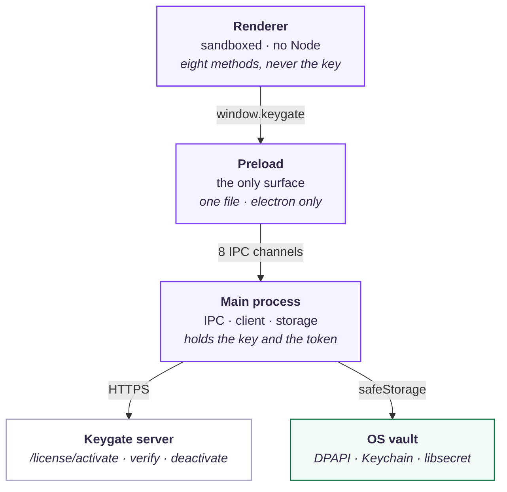

# Architecture

Where the credential lives, and why it does not live in the page.

- [The shape](#the-shape)
- [What lives where](#what-lives-where)
- [The eight channels](#the-eight-channels)
- [What a call actually does](#what-a-call-actually-does)
- [The device identifier](#the-device-identifier)
- [Storage](#storage)
- [The two packaging rules](#the-two-packaging-rules)
- [The build](#the-build)

---

## The shape



Three processes, and one rule: **the credential stays in the main process.**
The renderer asks for things; it never holds the license key and never
talks to the server.

That diagram is **Mermaid**, and this block is its source — GitHub renders
it live here. `npm run assets` renders the same block to
`assets/architecture.png`, which is what the README shows, because the npm
package page does not render Mermaid. Edit the block above, run the script,
and both stay in step. The block carries its own layout settings, so GitHub
and the PNG break the labels in the same places.

## What lives where

| Process | Has | Does not have |
| --- | --- | --- |
| **renderer** | eight methods on `window.keygate` | the key, the token, `fs`, `ipcRenderer`, any way to name a channel |
| **preload** | the bridge, and nothing else | the key, the token, any dependency except `electron` |
| **main** | the key, the token, the service | a way for the page to reach any of it directly |

The renderer is **untrusted input**. A page can be compromised — a remote
script injection, a malicious dependency, an ad — and whatever it can reach,
it can call. So the design is not "the page is careful", it is "the page
cannot reach the credential even if it tries".

## The eight channels

There is no arbitrary-invoke channel. The renderer cannot name a channel, so
it cannot reach a handler that was not meant for it.

| Channel | Method | Arguments |
| --- | --- | --- |
| `keygate:get-license` | `getLicense()` | none |
| `keygate:get-license-key` | `getLicenseKey()` | none |
| `keygate:activate` | `activate()` | `{ key, label?, identifier?, identifierType? }` |
| `keygate:verify` | `verify()` | `{ key?, identifier? }` |
| `keygate:deactivate` | `deactivate()` | `{ key?, identifier? }` |
| `keygate:get-entitlements` | `getEntitlements()` | `{ key?, feature? }` |
| `keygate:reset-license` | `resetLicense()` | none |
| `keygate:reset-license-key` | `resetLicenseKey()` | none |

Every handler does the same three things, in this order:

1. **Sender policy** — the requesting web contents must be in the trust list
   *and* the frame must be that window's main frame.
2. **Argument validation** — the payload is checked before any licence is
   touched.
3. **Envelope** — success is `{ ok: true, data }`, failure is
   `{ ok: false, error: { code, detail } }`.

Nothing throws across the boundary. `contextBridge` strips custom fields off
thrown objects, so a failure has to travel as data or it arrives as an
anonymous `Error` with the message lost.

## What a call actually does

`keygate.activate({ key })`, end to end:

1. **The renderer** calls the bridge, which invokes `keygate:activate`.
2. **The main process** checks the sender: trusted id, main frame.
3. **The main process** validates the arguments: a string, at most 256
   characters, no control characters.
4. **The main process** probes the OS vault — *before* the network call. A
   licence that cannot be stored would look like one the app has and cannot
   keep, and it is better to fail before the server thinks a slot was taken.
5. **The main process** derives the device identifier and hashes it.
6. **The main process** calls `POST /license/activate`, with an
   `Idempotency-Key` so a retry after a dropped connection cannot take a
   second slot.
7. **The main process** verifies the returned token's signature against the
   server's public key, and checks the token's device binding.
8. **The main process** writes the key and the token to the vault.
9. **The main process** answers `{ ok: true, data: license }`.
10. **The renderer** gets the license — which carries the entitlements, the
    status and the expiry, and **not** the key.

## The device identifier

Keygate identifies a device by a caller-supplied identifier string, and
binds the signed token to it with `sha256(identifier + ":" + product_id)`.
The identifier therefore has two jobs: **stable** across launches, so an
activation survives a restart, and **unique** per machine, so two machines do
not collide on one slot.

This package derives it from the operating system's own machine id:

| Platform | Source |
| --- | --- |
| Windows | `MachineGuid` from the registry |
| macOS | `IOPlatformUUID` from `ioreg` |
| Linux | `/etc/machine-id`, then `/var/lib/dbus/machine-id` |

The raw value is **hashed** before it is sent — `sha256`, first 32 hex
characters, prefixed `kg-`. The machine id is a stable handle on the host,
and the server has no reason to have it in the clear.

When no machine id can be read, the identifier is empty and the call fails
with `NO_IDENTIFIER` rather than silently becoming `""`.

## Storage

Under `app.getPath("userData")`:

```
keygate/key       the license key, encrypted
keygate/token     the signed token and its derived state, encrypted
keygate/pubkey    the verification public key, encrypted
```

All three go through `safeStorage`, so the files on disk are ciphertext.
There is **no plaintext fallback** — see [Security](security.md#the-os-vault)
for what that means on Linux.

The public key is cached too. It is public information, but caching it means
a machine with no network can still verify the token it already holds.

## The two packaging rules

Both of these have bitten real apps, and both are why this package hands you
a helper instead of a string.

**1. Resolve the preload through the package's own resolution.**
`keygateSandboxedPreloadPath()` finds the package directory with Node's own
`require.resolve('electron-plugin-keygate/package.json')`, which walks the
`node_modules` chain from the calling file, and then lets the package's
`exports` map decide the file name.

Resolving it relative to `import.meta.url` instead produced a path inside
the **app's own** directory when the app bundled its main script — the
package's code was inlined, `import.meta.url` pointed at the app's bundle,
and there was no preload file there. The renderer silently found no bridge.

**2. Keep the preload self-contained.**
A sandboxed renderer can load a CommonJS preload and nothing else: not an
ESM module, not a file outside its own directory, not a package it cannot
resolve. So `dist/preload/sandboxed.cjs` has the bridge bundled in at build
time, with `electron` as the only external.

An app that uses `sandbox: false` can use `dist/preload/index.mjs` instead,
which is ESM and loads the same bridge.

## The build

`npm run build` bundles five entry points with esbuild and writes the type
declarations with `tsc`:

| Entry | Format | For |
| --- | --- | --- |
| `dist/main/index.js` | ESM | the main process |
| `dist/renderer/index.js` | ESM | the renderer |
| `dist/preload/index.mjs` | ESM | the preload, `sandbox: false` |
| `dist/preload/sandboxed.cjs` | CommonJS | the preload, `sandbox: true` |
| `dist/preload/api.js` | ESM | `createKeygateBridge(invoke)`, with no `electron` import |

`dist/preload/api.js` exists so the bridge can be tested — and reused —
without Electron at all: it takes the `invoke` function as an argument and
imports nothing.

The `exports` map in `package.json` is the public surface. There is no
`require` condition on the main and renderer entries: they are ESM-only,
because a renderer bundle that is `require`-able is a renderer bundle that
can be loaded by something that is not a renderer.
