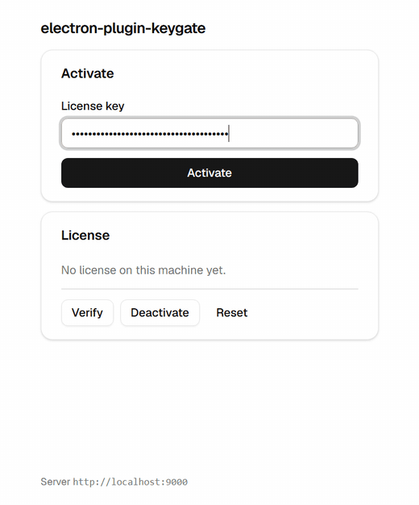

# Demo app

A runnable Electron app that drives `electron-plugin-keygate` end to end:
activate a key, read the license back, check in with the server, release
the device slot, and clear the cached state.

It is the wiring from the README, in a window you can click — no mock
server, no fixtures. The renderer imports
`electron-plugin-keygate/renderer`, exactly as application code does, and
never touches the key storage, the token, or the channel names.



## Run it

The demo consumes the package the way an app does — from `node_modules`,
through its `exports` map — so the package has to be built first.

```sh
# 1. build the package (repository root)
npm run build

# 2. install and start the demo
cd examples/demo
npm install
npm start
```

`npm start` bundles the app and opens it.

## The stack

| | |
| --- | --- |
| Renderer | React 19, Vite, Tailwind CSS v4 |
| UI | shadcn/ui components, copied from the [Watermelon UI](https://ui.watermelon.sh) registry |
| Main process | esbuild, `electron` external |

The components are vendored, not a dependency — the shadcn CLI copies the
source into `src/components/ui/`, so it is yours to edit. To pull them
again after a registry update:

```sh
npx shadcn@latest add @watermelon/button @watermelon/input @watermelon/card @watermelon/badge @watermelon/label @watermelon/separator -o
```

`components.json` points at the registry. The theme is the shadcn default
in `src/index.css` — neutral, light, no gradients.

## Point it at a server

| Variable | Meaning | Default |
| --- | --- | --- |
| `KEYGATE_API_URL` | The Keygate server. | `http://localhost:9000` |
| `KEYGATE_PUBLIC_KEY` | Pin the Ed25519 public key (64 hex chars). | fetched and cached |
| `KEYGATE_IDENTIFIER` | Override the device identifier. | this machine's id |

The default points at a **local** Keygate server, so the demo never talks
to production unless you ask it to. The URL in the footer is the one it is
really using.

The public key is fetched from the server and cached on first use. Pin it
with `KEYGATE_PUBLIC_KEY` and the demo will trust no key the server hands
out — which is what you want in anything you ship.

## What each button does

| Button | Call | What you should see |
| --- | --- | --- |
| **Activate** | `activate({ key })` | The license appears, the badge turns to *Licensed*. |
| **Verify** | `verify({})` | A fresh check-in against the server. |
| **Deactivate** | `deactivate({})` | This device's slot is released. |
| **Reset** | `resetLicense()` | The cached license is forgotten; the key stays. |

The **Licensed** badge is the whole point: it is only ever set after the
signed token verified against the server's public key. A failure shows the
server's own code — `LICENSE_NOT_FOUND`, `ACTIVATION_LIMIT`,
`DEVICE_HELD`, `LICENSING_DISABLED` — with its `detail`.

## The offline path

Activate, quit the app, and start it again with the server stopped. The
license still comes up: it was restored from the OS vault, and the
**offline · cached** badge says so. `license.offline` is `true`, which is
the flag to show the user that the state is cached rather than confirmed.

## Notes

- The window runs with `sandbox: true` and `contextIsolation: true`, and
  loads the package's **sandboxed** preload — one self-contained
  CommonJS file. That is the layout the README describes, not a special
  case for the demo.
- The key is typed into the UI and handed to the main process. It is
  stored under the OS vault (DPAPI on Windows) and is never written to
  disk by this app.
- To try the demo against the **published** package instead of the working
  tree, change the dependency in `package.json` to
  `"electron-plugin-keygate": "^0.1.1"` and run `npm install` again.
